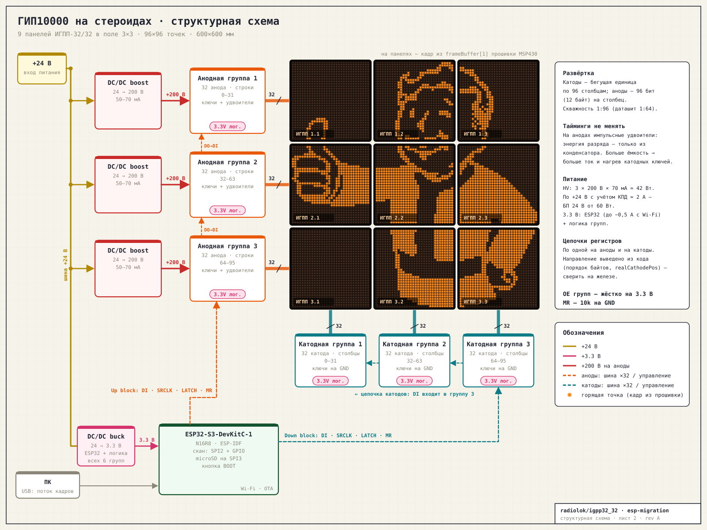
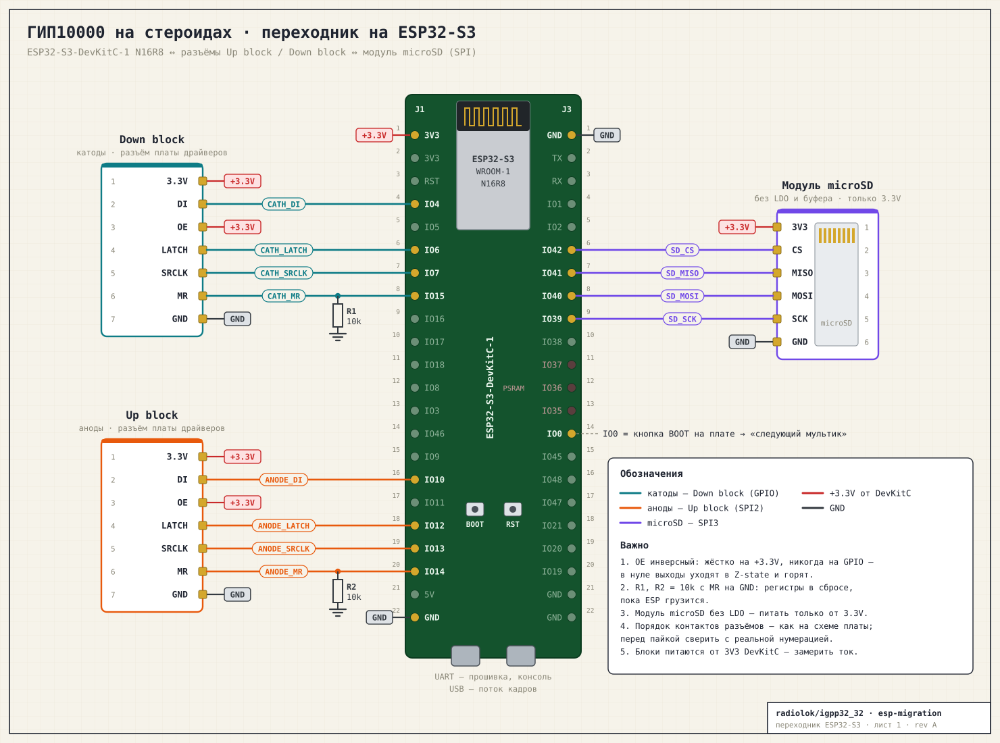

# Переезд ГИП10000-на-стероидах с MSP430 на ESP32-S3

Цель: заменить связку MSP430F5529 LaunchPad + FT2232 на проводах на ESP32-S3,
подключённую напрямую к разъёмам Up block / Down block. Добавить автономное
воспроизведение мультиков с SD-карты. Срок — ближайший фестиваль (~2 недели).

## Исходное состояние

### Что есть в репозитории

| Ветка | Железо | Аноды | Катоды | Примечание |
|---|---|---|---|---|
| `cathodeSpi` (2020-11-04) | родная плата, MSP430F5510 | UCA0 SPI, P4.0 SRCLK / P4.4 DI | UCB0 SPI, P4.1 DI / P4.3 SRCLK, 12 байт бегущей единицы | распиновка совпадает со схемой, буферы переключаются каждые 50 кадров |
| `master` (2020-11-08) | LaunchPad F5529 на проводах | UCB0 SPI, P3.0 / P3.2 | вручную, P4.1 DI / P4.3 CLK | защёлки и MR на P6.x, приём кадров по UART 500 кбод через FT2232 |

Прошивка, которая реально работает на LaunchPad, в репозитории, скорее всего,
отсутствует: по константам в коде частота кадров не сходится с наблюдаемой
(см. ниже). Её нужно найти локально или вычитать из LaunchPad.

### Формат кадра

- 96×96 точек, 1152 байта.
- Хранение по столбцам: 12 байт на столбец, старший бит — верхняя точка.
- Аноды инверсные: `0` — горит, `0xFF` — погашено.
- Порядок панелей по катодам развёрнут:
  `real = (64 - (pos & 0xE0)) + (pos & 0x1F)`.
- Формат совпадает с выводом `igpp.py --byte`.

### Цикл одного столбца (по коду `master`)

1. Таймер: импульс MR анодов, по SPI уходит 12×`0xFF` (гашение).
2. DMA закончил: катод сдвигается на шаг (на столбце 0 — сброс, DI=1, такт),
   ожидание `UCBUSY`, защёлкиваются обе цепочки.
3. По SPI уходят 12 байт данных столбца, ожидание `UCBUSY`, защёлкиваются обе
   цепочки.

Ожидание `UCBUSY` перед защёлкой обязательно: DMA сообщает о завершении, когда
последний байт ещё не вышел из сдвигового регистра.

### Тайминги — не трогать

На анодах стоят импульсные удвоители на конденсаторах. Более длинный столбец
не даёт больше энергии: разряд питается только от конденсатора. Если поднять
ёмкость, вырастет ток катодных ключей и они будут греться.

**Поэтому ESP-версия обязана повторить текущие тайминги точно.** Это
период столбца, длительность гашения, частота SPI и порядок защёлок. Источник
истины — эталонная запись анализатором с работающей связки (задача 0), а не
константы из репозитория.

Расхождение, которое надо объяснить:
- `master`: `TA0CCR0 = 906` при SMCLK ≈ 24 МГц / 4 → столбец ≈ 6,6 кГц → кадр ≈ 69 Гц.
- `cathodeSpi`: `TA0CCR0 = 606` → столбец ≈ 9,9 кГц → кадр ≈ 103 Гц.
- Наблюдаемое обновление ≈ 400 Гц (на видео нет мерцания). Это столбец ≈ 26 мкс,
  а в коде на столбец уходят 24 байта на 6 МГц ≈ 32 мкс. С кодом из репозитория
  так не получится.

Известное ограничение: по даташиту ИГПП-32/32 максимальная скважность 1:64, у
нас 1:96. На части плат из-за этого тяжело зажигаются некоторые строки.
Программно это не лечится, изменение таймингов исключено (см. выше).

## Железо

### Структура

Генерируется `tools/gen_system.py fw/igpp32-32/Igpp.c docs/img/system-overview.svg`;
на панелях — кадр `frameBuffer[0]` из прошивки.

- Питание: вход +24 В; на каждую анодную группу свой DC/DC boost 24→200 В
  (50–70 мА); DC/DC buck 24→3.3 В на ESP32 и логику всех шести групп.
- HV-бюджет: 3 × 200 В × 70 мА ≈ 42 Вт, по +24 В с учётом КПД около 2 А.

### Плата

ESP32-S3-DevKitC-1 N16R8 (есть в наличии) + модуль microSD на макетке:
- нативный USB (CDC без FT2232);
- 16 МБ флеша, запасной носитель (≈14 000 сырых кадров);
- 8 МБ PSRAM;
- свободный SPI3 под microSD (или SDMMC-хост, если модуль позволяет).

### Подключение к разъёмам

Схема генерируется скриптом `tools/gen_wiring.py`. GPIO выбраны так, чтобы
контакты разъёмов шли с тем же шагом, что и гребёнка DevKitC (J1 №3–9 и №15–21),
и все провода получились прямыми.

| Сигнал | Up block (аноды) | Down block (катоды) |
|---|---|---|
| 3.3V | +3.3V | +3.3V |
| DI | GPIO10 (SPI2 MOSI) | GPIO4 |
| OE | **жёстко на +3.3V** | **жёстко на +3.3V** |
| LATCH | GPIO12 | GPIO6 |
| SRCLK | GPIO13 (SPI2 CLK) | GPIO7 |
| MR | GPIO14, 10k на GND (R2) | GPIO15, 10k на GND (R1) |
| GND | GND | GND |

SPI2 выведен через GPIO matrix, а не IO_MUX: на 6 МГц это не важно.

- **OE на разъёме инверсный: выходы включены, когда на OE подан VCC.**
  Поэтому OE жёстко соединяем с 3.3V и на ногу МК не заводим никогда. Если OE
  упадёт в ноль (или будет висеть во время загрузки), регистры уйдут в Z-state,
  а подтяжек на выходах нет — выход сгорит. Гашение анодов делается только
  сдвигом `0xFF`.
- Катоды двигаются через GPIO, одним тактом на столбец. SPI3 занят под microSD.
- microSD — модуль на макетке. Типовые модули выводят только SPI (CS/SCK/MOSI/MISO)
  и часто стоят с буфером 74LVC125 и LDO, поэтому SDMMC через них не работает.
  Карта идёт по SPI3 (он всё равно свободен): SCK 39, MOSI 40, MISO 41, CS 42.
  Заказанный модуль — без LDO и буфера (разъём, 4 резистора, 2 конденсатора),
  питать только от 3.3V. Поток 1152 Б × 25 fps ≈ 29 КБ/с — для SPI это ничто.
- Модуль «голый», поэтому на тех же проводах работает и SDMMC 1-bit
  (SCK→CLK 39, MOSI→CMD 40, MISO→D0 41, CS=D3 держать в 1). Начинаем с SPI,
  переключение — настройкой в прошивке.
- Кнопка «следующий мультик»: GPIO0 (BOOT).
- Не использовать: 26–32 (флеш), 33–37 (octal PSRAM), 19/20 (USB), 43/44
  (консоль), 38 (RGB LED на DevKitC v1.1), strapping 3/45/46.
- Поведение выбранных ног при ресете проверить анализатором (задача 0b).

### Безопасное состояние

Безопасно — когда регистр катодов сброшен и ни один катод не выбран. Защита в
четыре слоя (реализовано, см. `fw-esp32/README.md`):

1. Подтяжка MR к GND, чтобы во время загрузки регистры держались в сбросе.
2. Хук загрузчика (`bootloader_components/igpp_boot_hooks`): сброс и защёлка
   цепочки катодов через несколько миллисекунд после ресета.
3. Сторож на CPU0: кадры не идут дольше 50 мс — катоды отключаются, перезагрузка.
4. Паника → тихая перезагрузка (`CONFIG_ESP_SYSTEM_PANIC_SILENT_REBOOT`) → п.2.

## Прошивка (ESP-IDF, C++) — `fw-esp32/`

Набросана без железа, собирается в CI (`.github/workflows/esp32.yml`):
хост-тесты ядра и утилит + сборка под ESP32-S3 с проверкой, что обработчик скана
лежит в IRAM и не вызывает код из флеша. Подробности — `fw-esp32/README.md`.

| Компонент | Что делает |
|---|---|
| `igpp_core` | кадр, развёртка `Scanner<Port>` (повторяет `Igpp.c`), протокол USB, `.igv`, тестовые узоры; 23 хост-теста |
| `igpp_display` | весь столбец — в IRAM-прерывании GPTimer на CPU1; SPI2 через регистры (12 байт в буфере SPI, без DMA); ожидание конца передачи перед защёлкой; двойной буфер; сторож |
| хук загрузчика | безопасное состояние сразу после ресета |
| `main/storage` | microSD на SPI3 (`/sd`), FAT-раздел ~13,9 МБ во флеше (`/flash`) |
| `main/player` | плейлист: `.igv`, папки `.bin`, встроенные узоры; кнопка BOOT; тестовый режим |
| `main/usb_link` | нативный USB CDC: сырые кадры `igpp.py` с пересинхронизацией + пакеты `IGP2` (команды, загрузка файлов) |
| `tools/igv.py` | видео/GIF/картинки → `.igv` (дизеринг), превью, стрим, загрузка, управление |
| Wi-Fi (опционально) | ещё не сделано |

Скан работает в прерывании, а не в задаче: при записи во флеш FreeRTOS ставит
второе ядро на паузу, и столбец остался бы гореть десятки миллисекунд.
IRAM-прерывания при этом продолжают работать.

### Формат `.igv`

- Заголовок 32 байта: магия `IGV1`, версия, ширина, высота, размер кадра, число
  кадров, длительность кадра в мс, флаги (зацикливание).
- Дальше кадры по 1152 байта в нативной раскладке панели. Плеер только копирует
  их в буфер, без преобразований.

## Стенд

Машина с USB: DevKit (нативный USB и UART-мост — прошивка и ресет),
логический анализатор (не меньше 8 каналов и 24 МС/с), веб-камера на индикатор.

- **Анализатор** (sigrok-cli): декодирование SPI, проверка периода столбца,
  порядка защёлок и джиттера, сравнение с эталоном.
- **Камера**: зажигаем 4 угловые точки, строим гомографию, считываем сетку
  96×96 и сравниваем с ожидаемым кадром. Это автотест «кадр → экран».

## План

### Неделя 1 — ядро

| # | Задача | Готово, когда |
|---|---|---|
| 0a | Найти или вычитать рабочую прошивку LaunchPad (eZ-FET, mspdebug/UniFlash), достать реальные константы таймера, SPI и клоков | константы известны, бинарник сохранён в репо |
| 0b | Эталонная запись анализатором со всех 8 линий текущей связки + поведение ног при ресете | есть файл записи и таблица таймингов в `docs/` |
| 1 | Калибровка камеры, скрипт считывания кадра | битовая карта с экрана совпадает с тестовым узором |
| 2 | Переходник: DevKit ↔ Up/Down block, MR на GND через 10k, OE на 3.3V, microSD | прозвонка, замер тока по 3.3V |
| 3 | Скан и защита на железе: тайминги из 0b в `menuconfig`, тестовые узоры (**код готов**) | запись анализатора совпадает с эталоном 0b, камера подтверждает узоры |
| 4 | USB-канал, совместимый с `igpp.py` (**код готов**) | старый скрипт работает без изменений, несколько часов без сбоев |

### Неделя 2 — автономность

| # | Задача | Готово, когда |
|---|---|---|
| 5 | Плеер: SD + флеш, `.bin` и `.igv`, плейлист, кнопка (**код готов**) | автономно крутит набор мультиков по кругу |
| 6 | `tools/igv.py`: видео/GIF → `.igv` (ffmpeg, дизеринг), превью (**готово**) | мультик с карты совпадает с ПК-рендером кадр в кадр |
| 7 | (опционально) `net`: точка доступа, веб-страница, OTA | управление с телефона |
| 8 | Прогон 8+ часов, заморозка прошивки за 2–3 дня до фестиваля | без зависаний и перезагрузок |

**Обязательно к фестивалю:** 0–5 и 8. Остальное — по остатку времени.

## Открытые вопросы

- Где рабочая прошивка LaunchPad и почему обновление ≈ 400 Гц.
- Модель логического анализатора.
- Какой модуль microSD: SPI с буфером или «голый».
- Ток потребления блоков по 3.3V: хватит ли LDO DevKit вместе с Wi-Fi.
