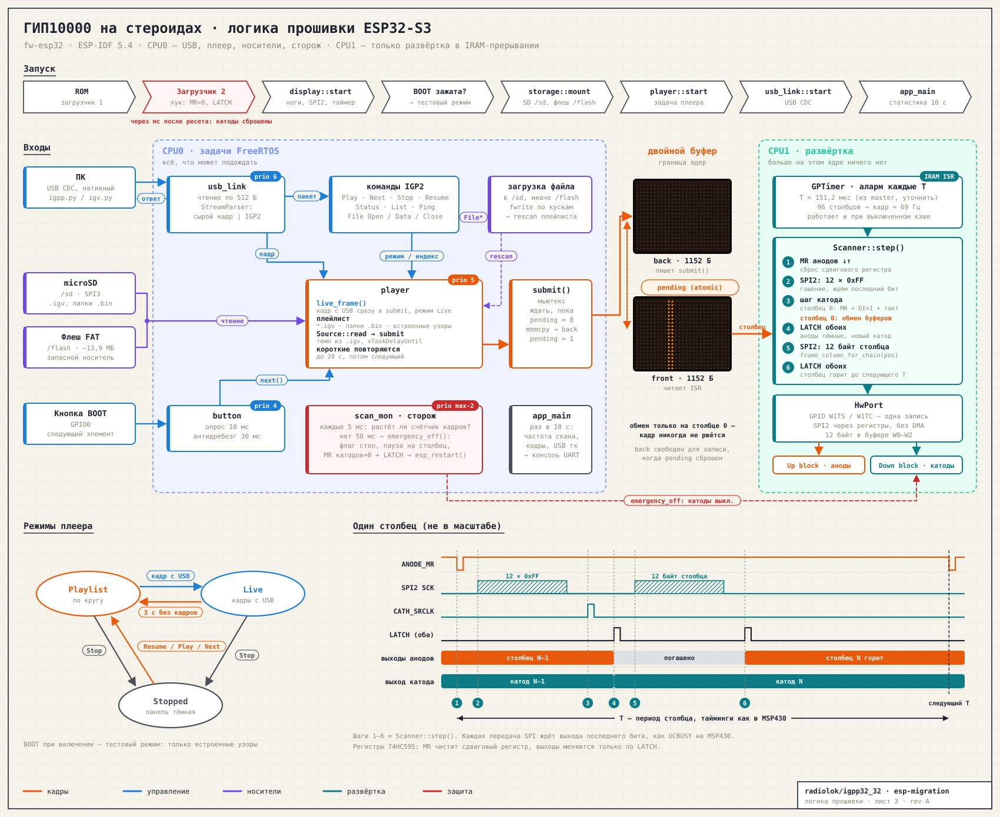

# ГИП10000 на стероидах — прошивка ESP32-S3

ESP32-S3-DevKitC-1 N16R8, ESP-IDF 5.4, C++17. Подключение — `docs/img/esp32-wiring.svg`,
план переезда — `docs/esp32-migration.md`.



Схема генерируется `tools/gen_firmware.py docs/img/firmware-logic.svg`.

## Сборка и прошивка

```sh
cd fw-esp32
idf.py set-target esp32s3
idf.py build
idf.py -p /dev/ttyUSB0 flash monitor     # порт «UART» на DevKit
```

Готовые бинарники собирает CI (`.github/workflows/esp32.yml`, артефакт `igpp-esp32s3`):
`igpp-esp32s3-full.bin` прошивается одной командой с адреса 0:

```sh
esptool.py --chip esp32s3 write_flash 0 igpp-esp32s3-full.bin
```

Хост-тесты ядра (без железа):

```sh
cmake -S fw-esp32/test/host -B build-host && cmake --build build-host && ctest --test-dir build-host
```

## Устройство

| Часть | Где | Что делает |
|---|---|---|
| `igpp_core` | `components/igpp_core` | формат кадра, развёртка `Scanner<Port>`, протокол USB, `.igv`, тестовые узоры. Без зависимостей от ESP-IDF, покрыто хост-тестами |
| `igpp_display` | `components/igpp_display` | скан в IRAM-прерывании GPTimer на CPU1, SPI2 напрямую через регистры, двойной буфер, сторож остановки скана |
| хук загрузчика | `bootloader_components/igpp_boot_hooks` | сразу после ресета сбрасывает и защёлкивает цепочку катодов |
| `main` | `main/` | SD (SPI3) и FAT во флеше, плеер, USB-канал, кнопка BOOT |

### Развёртка

Последовательность на столбец повторяет `Igpp.c` из `master`:
сброс анодов (MR) → 12×`0xFF` по SPI → шаг катода → защёлка → данные столбца → защёлка.
Каждая передача по SPI дожидается выхода последнего бита (как `UCBUSY` на MSP430).

Весь столбец выполняется в прерывании GPTimer (IRAM-safe, приоритет 3) на CPU1. Это прерывание
работает и при выключенном кэше флеша (запись FAT, NVS), поэтому ни один столбец не может
остаться гореть дольше периода. CI проверяет, что обработчик лежит в IRAM и не зовёт код
из флеша (`tools/check_scan_iram.sh`).

Тайминги — в `menuconfig → IGPP display`:

| Параметр | По умолчанию | Откуда |
|---|---|---|
| `IGPP_COLUMN_PERIOD_TENTHS_US` | 1512 (151,2 мкс) | `TA0CCR0 = 906` при SMCLK 24 МГц / 4 в `master` |
| `IGPP_SPI_CLOCK_HZ` | 6 000 000 | 24 МГц / 4 в `master` |

**Обе цифры — из кода `master`, а не с живой панели.** Их нужно заменить значениями из
эталонной записи анализатором (задача 0 плана): аноды питаются через импульсные удвоители
и работают только на исходных таймингах.

### Защита

1. 10k с MR на GND держат регистры в сбросе при загрузке.
2. Хук загрузчика защёлкивает сброшенную цепочку катодов через несколько миллисекунд после ресета.
3. Сторож на CPU0: если кадры не идут дольше `IGPP_STALL_TIMEOUT_MS` (50 мс) — катоды
   отключаются, плата перезагружается.
4. Паника → тихая перезагрузка (`CONFIG_ESP_SYSTEM_PANIC_SILENT_REBOOT`) → п.2.

Для отладки с бэктрейсами можно временно включить `PANIC_PRINT_REBOOT`.

## Контент и плейлист

Плеер ищет в корне SD (`/sd`) и FAT-раздела флеша (`/flash`, ~13,9 МБ):

* `*.igv` — анимации (`tools/igv.py convert`);
* папки с сырыми кадрами по 1152 байта (как `igpp.py --byte`), 40 мс на кадр.

Если ничего нет — играют встроенные узоры: картинка из прошивки MSP430, границы панелей с
номерами, шахматка, бегущий столбец, бегущая строка, бегущая точка, всё горит.
**BOOT, зажатая при включении** — тестовый режим, только встроенные узоры.
**BOOT во время работы** — следующий элемент. Короткие анимации повторяются до 20 с.

## USB

Нативный порт «USB» — канал данных (CDC), порт «UART» — консоль и прошивка.

* Старый формат: сырые кадры по 1152 байта — `igpp.py` работает как есть.
  Пауза больше 10 мс посреди кадра сбрасывает его, так что потерянный байт больше не
  сдвигает поток навсегда.
* Пакеты `IGP2`: кадр, play/next/stop/resume, статус, список, загрузка файлов.
  Формат — `components/igpp_core/include/igpp/protocol.hpp`.

После 3 с без кадров с USB плеер возвращается к плейлисту.

```sh
tools/igv.py convert clip.mp4 -o clip.igv --fps 25     # видео, GIF, картинки, папки
tools/igv.py preview clip.igv -o clip.gif
tools/igv.py upload  clip.igv --port /dev/ttyACM0       # на SD или во флеш
tools/igv.py send    clip.igv --port /dev/ttyACM0 --loop
tools/igv.py status  --port /dev/ttyACM0
```

## Проверить на стенде

| # | Что | Как |
|---|---|---|
| 1 | Ноги при ресете и в загрузчике | анализатор на 8 линиях, ресет: MR в нуле, импульс LATCH катодов, никаких тактов |
| 2 | Тайминги против эталона MSP430 | период столбца, гашение → данные, порядок защёлок, частота SPI |
| 3 | Длительность импульсов SRCLK/LATCH | ≥ 50 нс (12 `nop`); подправить `hold()` в `display.cpp` |
| 4 | Разводка цепочек | узор `test-panels`: номер панели 1–9 точками, диагонали поля |
| 5 | Все точки | `test-dots`, `test-columns`, `test-rows` + камера |
| 6 | Стриминг | `igpp.py` и `igv.py send` часами без сбоев |
| 7 | Запись во флеш во время скана | `igv.py upload` большого файла во флеш — скан не должен дёргаться |
| 8 | Сторож | остановить скан (отладчиком) — катоды гаснут, перезагрузка |
